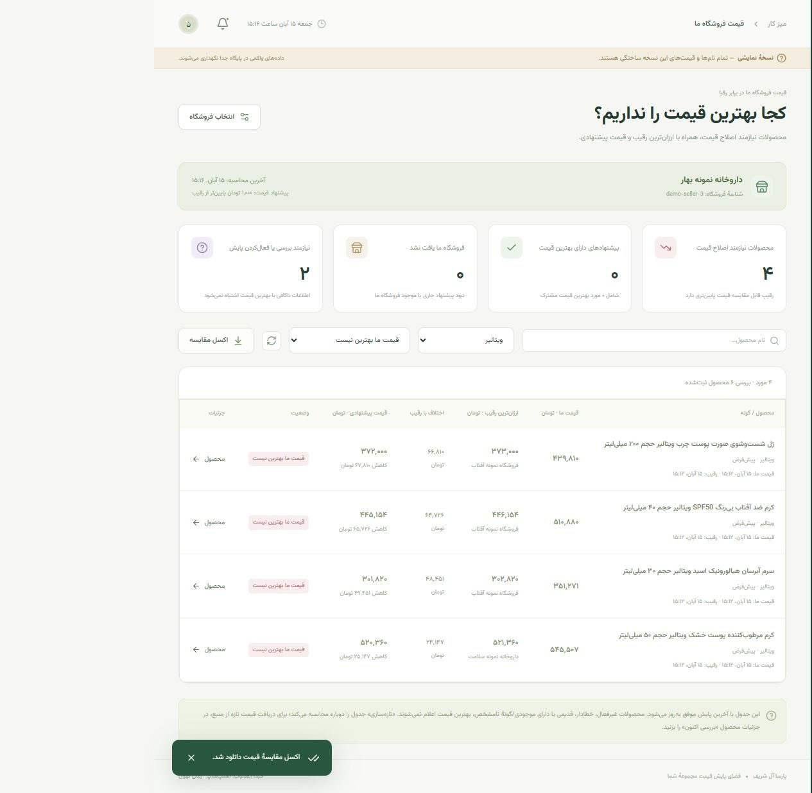

<div dir="rtl">

# DashAle — پارسا آل شریف

**پنل فارسی پایش قیمت محصولات و فروشندگان اسنپ‌شاپ**

محصولات برندهای خودتان را انتخاب کنید، قیمت فروشندگان را در زمان‌های مختلف
ببینید، از تغییرات باخبر شوید و گزارش اکسل بگیرید. با انتخاب فروشگاه خودتان،
برنامه نشان می‌دهد در کدام محصولات رقیب قیمت پایین‌تری دارد.

این راهنما برای فردی نوشته شده که برنامه‌نویسی بلد نیست. برای استفادهٔ روزمره
نیازی به Git، Docker یا نوشتن کد ندارید.

## قبل از شروع

- روش سادهٔ این راهنما برای **ویندوز ۱۰ یا ۱۱، نسخهٔ ۶۴بیتی** است.
- نصب اولیه و دریافت قیمت‌ها اینترنت می‌خواهند.
- برنامه روی همین کامپیوتر اجرا می‌شود. قراردادن کد روی GitHub آن را به
  سایت عمومی یا سرور ۲۴ساعته تبدیل نمی‌کند.
- اطلاعات واقعی و رمزهای نصب شخصی در مخزن نیستند. هر نصب رمز خودش را می‌سازد
  و شما محصولات خودتان را در پنل انتخاب می‌کنید.

## ۱. نصب دو پیش‌نیاز؛ فقط یک بار

### Python

از [سایت رسمی Python](https://www.python.org/downloads/windows/)، نسخهٔ
**۳٫۱۱ یا ۳٫۱۲** را نصب کنید. برای نصب‌کنندهٔ معمول ویندوز می‌توانید به
[صفحهٔ Python 3.12.10](https://www.python.org/downloads/release/python-31210/)
بروید و **Windows installer (64-bit)** را انتخاب کنید.

در پنجرهٔ اول نصب، تیک **Add python.exe to PATH** را بزنید؛ سپس
**Install Now** را انتخاب کنید. نصاب سادهٔ پروژه Python 3.11 و 3.12 را
شناسایی می‌کند؛ پروژه با Python 3.11 آزمایش شده است.

### Node.js

از [سایت رسمی Node.js](https://nodejs.org/en/download)، نسخهٔ **۲۲ LTS** و
نصب‌کنندهٔ ویندوز **Windows Installer (.msi)** را انتخاب کنید. نصب را با
تنظیمات پیش‌فرض تمام کنید. npm همراه آن نصب می‌شود.

بعد از نصب، پنجره‌های قدیمی ترمینال را ببندید. اگر نصاب هنوز این ابزارها
را نمی‌شناسد، ویندوز را یک بار راه‌اندازی مجدد کنید.

## ۲. دانلود و خارج‌کردن برنامه از ZIP

۱. [مخزن DashAle](https://github.com/thealih/DashAle) را باز کنید.

۲. دکمهٔ سبز **Code** و سپس **Download ZIP** را بزنید. اگر مخزن خصوصی باشد
باید با حسابی وارد GitHub شوید که به آن دسترسی دارد.

۳. روی فایل دانلودشده راست‌کلیک و **Extract All** را بزنید.

۴. پوشهٔ استخراج‌شده را مثلاً در `C:\DashAle` قرار دهید.
**فایل‌ها را از داخل ZIP اجرا نکنید.**

۵. وارد پوشه‌ای شوید که فایل‌های `Install.cmd`، `Run.cmd` و `README.md`
در آن کنار هم هستند. ممکن است این پوشه یک لایه داخل پوشهٔ دانلودشده باشد.

## ۳. نصب با دوبار کلیک

روی **Install.cmd** دوبار کلیک کنید.

پنجره‌ای باز می‌شود که محیط Python را می‌سازد، کتابخانه‌ها را دانلود می‌کند،
پنل را می‌سازد و تنظیمات اولیه و رمزهای همین نصب را آماده می‌کند.

نصب اول ممکن است چند دقیقه طول بکشد؛ پنجره را نبندید. وقتی پیام
`Installation complete` را دیدید، نصب تمام است. دفعات بعد لازم نیست این
فایل را اجرا کنید، مگر نسخهٔ جدیدی دریافت کرده باشید.

اگر خطا دیدید، متن آن را نگه دارید و بخش رفع اشکال پایین را بخوانید.
نصاب فایل تنظیمات `.env` موجود را بازنویسی نمی‌کند.

## ۴. اجرا و ورود

۱. روی **Run.cmd** دوبار کلیک کنید.

۲. بعد از آماده‌شدن سرور، مرورگر با این آدرس باز می‌شود:

[بازکردن پنل اصلی](http://127.0.0.1:8000/)

۳. در پوشهٔ برنامه، پوشهٔ `data` و فایل **local-access.txt** را باز کنید.
این فایل هنگام نصب ساخته می‌شود و داخل GitHub نیست.

۴. مقادیر مقابل `Admin username` و `Admin password` را در فرم ورود وارد کنید.
رمز طولانی است؛ آن را کپی کنید. نام کاربری پیش‌فرض `admin` است، اما
**رمز ثابت و عمومی وجود ندارد** و هر نصب رمز خودش را دارد.

حساب `Viewer` برای مشاهده و گزارش است. برای افزودن، حذف، شروع پایش یا
تنظیمات از حساب مدیر استفاده کنید.

### فایل‌هایی که روزمره لازم دارید

| فایل | کاربرد |
|---|---|
| `Install.cmd` | نصب اولیه یا ساخت نسخهٔ جدید |
| `Run.cmd` | اجرای پنل اصلی و بازکردن مرورگر |
| `Stop.cmd` | توقف سرور اصلی و پایش |
| `Demo.cmd` | اجرای نسخهٔ نمایشی برای تمرین |
| `Backup.cmd` | تهیهٔ پشتیبان از اطلاعات واقعی |

بستن تب مرورگر پایش را متوقف نمی‌کند؛ برای توقف `Stop.cmd` را بزنید.
با خاموش‌شدن کامپیوتر نیز پایش متوقف می‌شود؛ بعد از روشن‌شدن، `Run.cmd` را بزنید.

## ۵. انتخاب محصول و شروع پایش

هفت برند ویتالیر، ادورامکس، الوینا، آیسول، ویتاپلکس، بلفامد و برگامیا در
منو صفحهٔ مستقل دارند.

۱. وارد صفحهٔ برند شوید و **جست‌وجوی اسنپ‌شاپ** را بزنید.

۲. منتظر نتیجه یا پیام دریافت بمانید. محصولات خودتان را تیک بزنید.

۳. **شروع پایش** را بزنید. انتخاب تکی و گروهی وجود دارد.

۴. پس از اولین دریافت موفق، قیمت‌ها ثبت می‌شوند. با کلیک روی کارت، جدول
فروشندگان، زمان مشاهده و تاریخچه را می‌بینید.

محصولی که فقط پیدا شده ولی انتخاب نشده، خودکار پایش نمی‌شود. دکمهٔ
«دریافت فروشندگان اکنون» در جزئیات برای مشاهدهٔ لحظه‌ای است؛ آن دریافت
بدون فعال‌کردن پایش وارد تاریخچه و اکسل پایش نمی‌شود.

### محصولی در جست‌وجو پیدا نشد

**افزودن محصول با لینک** را باز کنید، برند را انتخاب و لینک را وارد کنید:

```text
https://snappshop.ir/product/snp-983678429
```

«ثبت محصول و فعال‌کردن پایش» را بزنید. محصول موجود دوباره ساخته نمی‌شود؛
محصول جدید پس از دریافت معتبر ثبت و وارد پایش می‌شود. برند انتخابی شما
مبنای دسته‌بندی دستی است.

### محصول اشتباه یا متعلق به مجموعه نیست

پایین کارت، سطل زباله را بزنید. برای چند محصول، آن‌ها را تیک بزنید و
**حذف انتخاب‌شده‌ها** را انتخاب کنید. این محصولات از پایش، گزارش و مقایسه
کنار می‌روند و جست‌وجوی بعدی دوباره اضافه‌شان نمی‌کند.

برای برگشت از اشتباه، تب **حذف‌شده‌ها** و سپس **بازگردانی** را بزنید؛ بعد
پایش را دوباره فعال کنید. این حذف قابل بازگردانی است و با همان عمل سابقه
پاک نمی‌شود. نگهداری معمول تاریخچه تابع مدت تنظیم‌شدهٔ سامانه است.

## ۶. کجا بهترین قیمت را نداریم؟

۱. در **تنظیمات ← فروشگاه خودمان** نام فروشگاهتان را جست‌وجو کنید و
فروشگاه درست را از فهرست انتخاب کنید. شناسه کنار نام برای تشخیص هم‌نام‌هاست.

۲. اگر در فهرست نیست، «فروشگاه من هنوز در فهرست نیست» را باز کنید و شناسهٔ
واقعی فروشگاه در اسنپ‌شاپ و نام آن را وارد کنید.

۳. فاصلهٔ قیمت پیشنهادی را تعیین کنید؛ مثلاً ۱٬۰۰۰ تومان کمتر از رقیب.
ذخیره را بزنید و از منو وارد **قیمت فروشگاه ما** شوید.

جدول، قیمت شما، نام و قیمت ارزان‌ترین رقیب، اختلاف، قیمت پیشنهادی و کاهش
لازم را نشان می‌دهد. فیلتر برند، جست‌وجو، وضعیت و اکسل مقایسه هم دارد.

مثلاً با قیمت شما ۱۲۰٬۰۰۰، قیمت رقیب ۱۰۰٬۰۰۰ و فاصلهٔ ۱٬۰۰۰ تومان، پیشنهاد
۹۹٬۰۰۰ تومان و کاهش لازم ۲۱٬۰۰۰ تومان است.

مقایسه برای گونه و گارانتی یکسان، موجودی مشخص و دادهٔ تازه است. قیمت مساوی
بهترین قیمت مشترک است. محصول غیرفعال، ناموجود یا دارای اطلاعات قدیمی/ناقص
بهترین قیمت اعلام نمی‌شود. پیشنهاد را خودتان اعمال می‌کنید؛ برنامه قیمت
فروشگاه را خودکار تغییر نمی‌دهد.

## ۷. اعلان‌ها و اکسل

در **اعلان‌ها** تغییر قیمت، فروشندهٔ تازه، موجودی و خطاها را با زمان مشاهده
ببینید. فیلتر و علامت خوانده‌شده وجود دارد.

در **گزارش‌ها و خروجی** برند، محصول، فروشنده و تاریخ را انتخاب و
«ساخت و دانلود گزارش اکسل» را بزنید. فایل معمولاً در Downloads ذخیره می‌شود.

فایل شامل خلاصهٔ مدیریتی، آخرین قیمت‌ها، تغییرات و در صورت انتخاب، تاریخچه
است. شیت‌ها راست‌چین و دارای فیلترند و قیمت‌ها عددی و به تومان هستند.
بازه روی تغییرات و تاریخچه اعمال می‌شود؛ شیت آخرین قیمت‌ها، آخرین مشاهدهٔ
ثبت‌شده را نشان می‌دهد. برای گزارش بزرگ، برند یا بازه را محدود کنید.

**زمان‌ها به وقت تهران هستند.** سامانه زمان مشاهده را می‌داند، نه لحظهٔ
دقیق تغییر در اسنپ‌شاپ. قیمت برای مقصد تهران خوانده می‌شود و شامل هزینهٔ
ارسال و کوپن شخصی نیست. تغییر کوتاه بین دو بررسی ممکن است ثبت نشود.

## ۸. تنظیم زمان‌بندی و نسخهٔ تمرینی

در تنظیمات می‌توانید فاصلهٔ بررسی، آستانهٔ درصدی اعلان، فاصلهٔ کشف دوبارهٔ
محصولات و مدت نگهداری تاریخچه را تغییر دهید. پیش‌فرض، دریافت موفق هر محصول
با فاصلهٔ ۶۰ دقیقه و نگهداری مشاهدات ۳۰ روز است؛ الزاماً رأس ساعت نیست.

برای تمرین، **Demo.cmd** را بزنید:

[بازکردن نسخهٔ نمایشی](http://127.0.0.1:8001/)

نام‌ها و قیمت‌های آن **ساختگی و برچسب‌دار** هستند؛ گزارش بازار را از نسخهٔ
نمایشی تهیه نکنید. پایگاهش از دادهٔ واقعی جداست. برای توقف نسخهٔ نمایشی،
در پوشهٔ برنامه ترمینال باز کنید و بزنید:

```powershell
powershell -NoProfile -ExecutionPolicy Bypass -File .\stop.ps1 -Demo
```

## ۹. پشتیبان و به‌روزرسانی

### پشتیبان‌گیری

روی **Backup.cmd** دوبار کلیک کنید. فایل پشتیبان در **data/backups** ساخته
می‌شود؛ یک نسخه را در جای دیگری مانند حافظهٔ خارجی نگه دارید.

فایل‌های `.env` و `data/local-access.txt` اطلاعات خصوصی نصب هستند و نباید
در GitHub، گروه یا پیام عمومی منتشر شوند. برای بازیابی اطلاعات، پیش از
جایگزینی فایل پایگاه از مسئول فنی کمک بگیرید؛ جایگزینی اشتباه اطلاعات را بازنویسی می‌کند.

### دریافت نسخهٔ جدید

۱. `Backup.cmd` و سپس `Stop.cmd` را اجرا کنید.

۲. نسخهٔ جدید را جداگانه دانلود و از ZIP خارج کنید.

۳. فایل‌های کد جدید را روی پوشهٔ قبلی کپی کنید؛ **پوشهٔ data و فایل .env
قبلی را حذف یا جایگزین نکنید.** این دو در ZIP مخزن نیستند و اطلاعات شما هستند.

۴. `Install.cmd` و سپس `Run.cmd` را بزنید.

۵. در مرورگر **Ctrl + Shift + R** بزنید.

پوشه‌های `.venv` و `frontend/node_modules` را بین کامپیوترها منتقل نکنید؛
نصاب آن‌ها را برای هر دستگاه جدا آماده می‌کند.

## ۱۰. رفع اشکال

| مشکل | راه‌حل |
|---|---|
| `Python ... was not found` | Python 3.11 یا 3.12 را با تیک PATH نصب و Install.cmd را دوباره اجرا کنید. |
| `Node.js with npm is required` | Node.js 22 LTS را نصب و Install.cmd را دوباره اجرا کنید. |
| دانلود پکیج‌ها قطع می‌شود | اتصال و دسترسی به PyPI/npm را بررسی و پس از رفع، نصب را تکرار کنید. |
| صفحه باز نمی‌شود | Run.cmd را بزنید؛ آدرس دقیق `http://127.0.0.1:8000/` است. |
| ظاهر قدیمی مانده | بعد از نصب نسخهٔ جدید Ctrl + Shift + R بزنید. |
| رمز را ندارم | `data/local-access.txt` همین نصب را باز کنید؛ رمز روی GitHub نیست. |
| اسنپ‌شاپ خطای ۴۰۳ می‌دهد | دسترسی شبکهٔ اجرای سرور و VPN را بررسی کنید. |
| فروشندگان هنوز ثبت نشده‌اند | پایش را فعال یا در جزئیات دریافت لحظه‌ای کنید. |
| فروشنده‌ای یافت نشد | پاسخ موفق برای همان شناسه پیشنهاد فروش نداشته؛ لینک دقیق را با سایت تطبیق دهید. |
| قیمت قدیمی است | روشن‌بودن سرور، فعال‌بودن پایش، خطای محصول و زمان آخرین موفقیت را ببینید. |
| روی کامپیوتر دیگری باز نمی‌شود | localhost مخصوص همان دستگاه است؛ استفادهٔ شبکه‌ای به استقرار سروری نیاز دارد. |
| خطای پورت یا آماده‌نشدن سرور | Stop.cmd و Run.cmd را بزنید و در صورت ادامه، لاگ را بررسی کنید. |

لاگ اصلی **data/server-live-error.log** است؛ علاوه بر خطا، پیام‌های عادی
سرور را هم دارد. برای کمک‌گرفتن متن خطا را بفرستید، نه رمز یا `.env`.
اگر ویندوز اجرای فایلی را مسدود کرد، منبع فایل و محدودیت‌های سازمانتان را
با مسئول فنی بررسی کنید.

## ۱۱. فناوری‌ها و حدود اجرا

| بخش | فناوری |
|---|---|
| پنل | Next.js، React، TypeScript، CSS و Vazirmatn |
| نمودار و آیکون | Recharts و Lucide |
| سرور | Python، FastAPI و Uvicorn |
| پایگاه محلی | SQLite و SQLAlchemy |
| دریافت اطلاعات | curl_cffi و نشست مهمانِ رابط خواندنی اسنپ‌شاپ |
| اکسل | openpyxl |
| آزمون | pytest؛ ۶۵ آزمون در زمان تحویل پاس شده |
| پیکربندی سروری | Docker Compose، PostgreSQL، Redis و Celery |

برای اجرای محلی Docker، PostgreSQL و Redis لازم نیستند. رابط در نصب اولیه
ساخته و توسط همان FastAPI ارائه می‌شود. اجرای محلی روی SQLite و دو حلقهٔ
پس‌زمینه آزمایش شده است. ترکیب سروری Docker در دستگاه توسعه اجرا نشده و
بار کامل ۳۰۰ محصول × ۲۰۰ فروشنده اندازه‌گیری نشده است.

پروژه مستقل از اسنپ‌شاپ است؛ دسترسی و پاسخ رابط منبع ممکن است تغییر کند.
هنگام خطا، قیمت قبلی حفظ و خطا نمایش داده می‌شود و قیمت فرضی ثبت نمی‌شود.

توضیح کامل صفحات، جدول‌های پایگاه، فرمول مقایسه و زمان‌بندی در
[HOW_IT_WORKS.fa.md](HOW_IT_WORKS.fa.md) آمده است.

## ۱۲. برای مسئول فنی

نصب و اجرای دستی ویندوز:

```powershell
powershell -NoProfile -ExecutionPolicy Bypass -File .\setup.ps1
powershell -NoProfile -ExecutionPolicy Bypass -File .\launch.ps1
```

آزمون و ساخت:

```powershell
.\.venv\Scripts\python.exe -X utf8 -m pytest -q
cd frontend
npm.cmd run build
```

بررسی دسترسی منبع، بدون چاپ توکن:

```powershell
.\.venv\Scripts\python.exe -X utf8 scripts/probe_source.py
```

برای استقرار لینوکسی، پس از نصب Docker Engine و Compose:

```sh
python3 scripts/bootstrap.py
docker compose up -d --build
docker compose ps
docker compose logs --tail=100 api worker discovery-worker beat
```

برای دامنه و دسترسی اعضای مجموعه، reverse proxy با HTTPS تنظیم و
`SECURE_COOKIES=true` را فعال کنید. compose پورت برنامه را فقط روی localhost
باز می‌کند. پشتیبان زمان‌بندی‌شده و ظرفیت‌سنجی به استقرار واقعی وابسته‌اند.

مستندات API پس از اجرا: [Swagger](http://127.0.0.1:8000/docs).
خواندن داده‌ها به نشست معتبر نیاز دارد. وابستگی‌ها در `requirements.txt`،
نسخه‌های محیط آزمایش در `requirements-lock.txt` و تنظیمات نمونه در
`.env.example` هستند. رمز واقعی را در مخزن ثبت نکنید.

## تصویر نمونه

تصویر زیر از **نسخهٔ نمایشی با نام‌ها و قیمت‌های ساختگی** است:



## مجوز منابع

مجوز فونت، fixtureهای آزمون و منابع بررسی پروتکل در
[THIRD_PARTY_NOTICES.md](THIRD_PARTY_NOTICES.md) آمده است.

</div>
