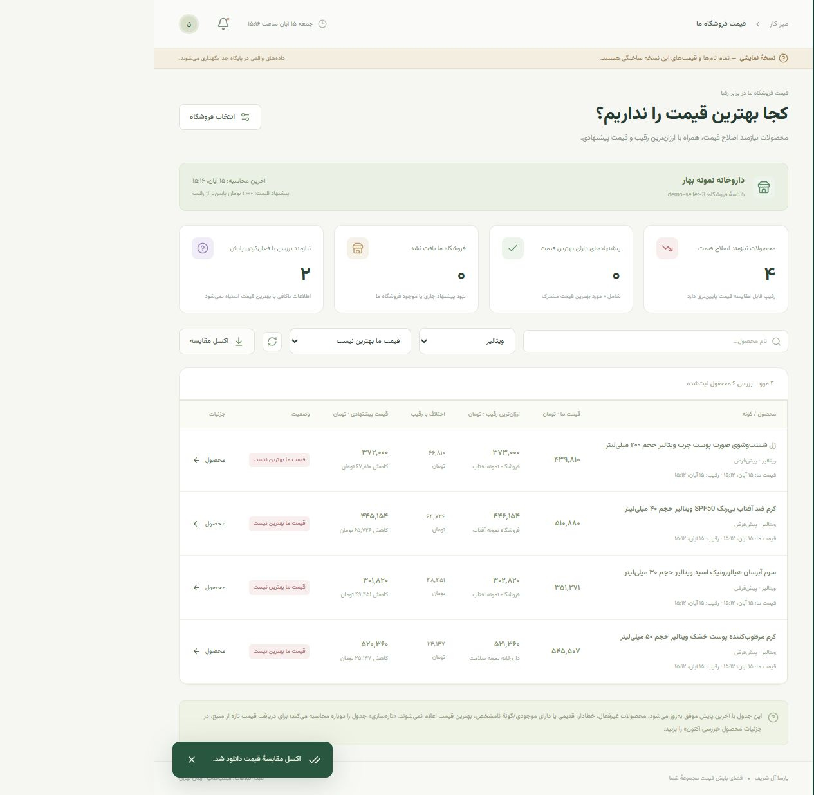

<div dir="rtl">

# DashAle — پارسا آل شریف

**پنل فارسی پایش قیمت محصولات و فروشندگان اسنپ‌شاپ**

محصولات برندهای خودتان را انتخاب کنید، قیمت فروشندگان را در زمان‌های مختلف
ببینید، از تغییرات باخبر شوید و گزارش اکسل بگیرید. با انتخاب فروشگاه خودتان،
برنامه نشان می‌دهد در کدام محصولات رقیب قیمت پایین‌تری دارد.

برای انتخاب سریع‌تر برند، محصول یا فروشنده، کادر انتخاب را باز و در جست‌وجوی
داخلی آن تایپ کنید؛ سپس روی نتیجه بزنید یا با Enter انتخاب کنید.

این راهنما برای فردی نوشته شده که برنامه‌نویسی بلد نیست. برای استفادهٔ روزمره
نیازی به Git، Docker یا نوشتن کد ندارید.

## ساختار پروژه

- `.Net/` بک‌اند فعال، فایل‌های نصب و اجرا و داده‌های محلی SQL Server.
- `frontend/` رابط مشترک پنل و خروجی ساخته‌شدهٔ آن.
- `python/` بک‌اند قدیمی، نسخهٔ نمایشی، آزمون‌ها و داده‌های SQLite.

## قبل از شروع

- روش سادهٔ این راهنما برای **ویندوز ۱۰ یا ۱۱، نسخهٔ ۶۴بیتی** است.
- نصب اولیه و دریافت قیمت‌ها اینترنت می‌خواهند.
- برنامه روی همین کامپیوتر اجرا می‌شود. قراردادن کد روی GitHub آن را به
  سایت عمومی یا سرور ۲۴ساعته تبدیل نمی‌کند.
- اطلاعات واقعی و رمزهای نصب شخصی در مخزن نیستند. هر نصب رمز خودش را می‌سازد
  و شما محصولات خودتان را در پنل انتخاب می‌کنید.

## ۱. نصب پیش‌نیازها

### ‎.NET و SQL Server LocalDB

[‎.NET 8 SDK](https://dotnet.microsoft.com/en-us/download/dotnet/8.0) نسخهٔ ۶۴بیتی و
**SQL Server Express LocalDB** را نصب کنید. در نصب SQL Server Express گزینهٔ
LocalDB را انتخاب کنید. LocalDB دیتابیس محلی پنل را روی همان کامپیوتر اجرا می‌کند.

### Node.js

از [سایت رسمی Node.js](https://nodejs.org/en/download)، نسخهٔ **۲۲ LTS** و
نصب‌کنندهٔ ویندوز **Windows Installer (.msi)** را انتخاب کنید. نصب را با
تنظیمات پیش‌فرض تمام کنید. npm همراه آن نصب می‌شود.

بعد از نصب، پنجره‌های قدیمی ترمینال را ببندید. اگر نصاب هنوز این ابزارها
را نمی‌شناسد، ویندوز را یک بار راه‌اندازی مجدد کنید.

## ۲. دانلود و خارج‌کردن برنامه از ZIP

۱. [مخزن DashAle](https://github.com/thealih/DashAle) را باز کنید.

۲. دکمهٔ سبز **Code** و سپس **Download ZIP** را بزنید. اگر مخزن خصوصی باشد
باید با حسابی وارد GitHub شوید که به آن دسترسی دارد.

۳. روی فایل دانلودشده راست‌کلیک و **Extract All** را بزنید.

۴. پوشهٔ استخراج‌شده را مثلاً در `C:\DashAle` قرار دهید.
**فایل‌ها را از داخل ZIP اجرا نکنید.**

۵. وارد پوشهٔ `.Net` شوید. فایل‌های `Install.cmd`، `Run.cmd`، `Stop.cmd` و `Backup.cmd` داخل این پوشه‌اند.

## ۳. نصب با دوبار کلیک

روی **Install.cmd** دوبار کلیک کنید.

پنجره‌ای باز می‌شود که وابستگی‌ها را دانلود می‌کند و پنل و سرور ‎.NET را می‌سازد.
در اولین اجرا، دیتابیس و دو حساب محلی ساخته می‌شوند.

نصب اول ممکن است چند دقیقه طول بکشد؛ پنجره را نبندید. وقتی پیام
`Installation complete` را دیدید، نصب تمام است. دفعات بعد لازم نیست این
فایل را اجرا کنید، مگر نسخهٔ جدیدی دریافت کرده باشید.

اگر خطا دیدید، متن آن را نگه دارید و بخش رفع اشکال پایین را بخوانید.
اجرای نصب برای به‌روزرسانی، حساب‌ها و دیتابیس موجود را دوباره ایجاد نمی‌کند.

## ۴. اجرا و ورود

۱. روی **Run.cmd** دوبار کلیک کنید.

۲. بعد از آماده‌شدن سرور، مرورگر با این آدرس باز می‌شود:

[بازکردن پنل اصلی](http://127.0.0.1:8000/)

۳. در پوشهٔ `.Net`، پوشهٔ `data` و فایل **dotnet-access.txt** را باز کنید.
این فایل در اولین اجرا ساخته می‌شود و داخل GitHub نیست.

۴. مقادیر مقابل `Admin username` و `Admin password` را در فرم ورود وارد کنید.
رمز طولانی است؛ آن را کپی کنید. نام کاربری پیش‌فرض `admin` است، اما
**رمز ثابت و عمومی وجود ندارد** و هر نصب رمز خودش را دارد.

حساب `Viewer` برای مشاهده و گزارش است. برای افزودن، حذف، شروع پایش یا
تنظیمات از حساب مدیر استفاده کنید.

### فایل‌هایی که روزمره لازم دارید

| فایل | کاربرد |
|---|---|
| `Install.cmd` | نصب اولیه یا ساخت نسخهٔ جدید |
| `Run.cmd` | اجرای پنل اصلی و بازکردن مرورگر |
| `Stop.cmd` | توقف سرور اصلی و پایش |
| `Demo.cmd` | اجرای نسخهٔ نمایشی قدیمی پس از نصب جداگانه |
| `Backup.cmd` | تهیهٔ پشتیبان از اطلاعات واقعی |

بستن تب مرورگر پایش را متوقف نمی‌کند؛ برای توقف `Stop.cmd` را بزنید.
با خاموش‌شدن کامپیوتر نیز پایش متوقف می‌شود؛ بعد از روشن‌شدن، `Run.cmd` را بزنید.

## ۵. انتخاب محصول و شروع پایش

هفت برند ویتالیر، ادورامکس، الوینا، آیسول، ویتاپلکس، بلفامد و برگامیا در
منو صفحهٔ مستقل دارند.

۱. وارد صفحهٔ برند شوید و **جست‌وجوی اسنپ‌شاپ** را بزنید.

۲. منتظر نتیجه یا پیام دریافت بمانید. محصولات خودتان را تیک بزنید.

۳. **شروع پایش** را بزنید. انتخاب تکی و گروهی وجود دارد.

۴. پس از اولین دریافت موفق، قیمت‌ها ثبت می‌شوند. با کلیک روی کارت، جدول
فروشندگان، زمان مشاهده و تاریخچه را می‌بینید.

محصولی که فقط پیدا شده ولی انتخاب نشده، خودکار پایش نمی‌شود. دکمهٔ
«دریافت فروشندگان اکنون» در جزئیات برای مشاهدهٔ لحظه‌ای است؛ آن دریافت
بدون فعال‌کردن پایش وارد تاریخچه و اکسل پایش نمی‌شود.

### محصولی در جست‌وجو پیدا نشد

**افزودن محصول با لینک** را باز کنید، برند را انتخاب و لینک را وارد کنید:

```text
https://snappshop.ir/product/snp-983678429
```

«ثبت محصول و فعال‌کردن پایش» را بزنید. محصول موجود دوباره ساخته نمی‌شود؛
محصول جدید پس از دریافت معتبر ثبت و وارد پایش می‌شود. برند انتخابی شما
مبنای دسته‌بندی دستی است.

### محصول اشتباه یا متعلق به مجموعه نیست

پایین کارت، سطل زباله را بزنید. برای چند محصول، آن‌ها را تیک بزنید و
**حذف انتخاب‌شده‌ها** را انتخاب کنید. این محصولات از پایش، گزارش و مقایسه
کنار می‌روند و جست‌وجوی بعدی دوباره اضافه‌شان نمی‌کند.

برای برگشت از اشتباه، تب **حذف‌شده‌ها** و سپس **بازگردانی** را بزنید؛ بعد
پایش را دوباره فعال کنید. این حذف قابل بازگردانی است و با همان عمل سابقه
پاک نمی‌شود. نگهداری معمول تاریخچه تابع مدت تنظیم‌شدهٔ سامانه است.

## ۶. کجا بهترین قیمت را نداریم؟

۱. در **تنظیمات ← فروشگاه خودمان** نام فروشگاهتان را جست‌وجو کنید و
فروشگاه درست را از فهرست انتخاب کنید. شناسه کنار نام برای تشخیص هم‌نام‌هاست.

۲. اگر در فهرست نیست، «فروشگاه من هنوز در فهرست نیست» را باز کنید و شناسهٔ
واقعی فروشگاه در اسنپ‌شاپ و نام آن را وارد کنید.

۳. فاصلهٔ قیمت پیشنهادی را تعیین کنید؛ مثلاً ۱٬۰۰۰ تومان کمتر از رقیب.
ذخیره را بزنید و از منو وارد **قیمت فروشگاه ما** شوید.

جدول، قیمت شما، نام و قیمت ارزان‌ترین رقیب، اختلاف، قیمت پیشنهادی و کاهش
لازم را نشان می‌دهد. فیلتر برند، جست‌وجو، وضعیت و اکسل مقایسه هم دارد.

مثلاً با قیمت شما ۱۲۰٬۰۰۰، قیمت رقیب ۱۰۰٬۰۰۰ و فاصلهٔ ۱٬۰۰۰ تومان، پیشنهاد
۹۹٬۰۰۰ تومان و کاهش لازم ۲۱٬۰۰۰ تومان است.

مقایسه برای گونه و گارانتی یکسان، موجودی مشخص و دادهٔ تازه است. قیمت مساوی
بهترین قیمت مشترک است. محصول غیرفعال، ناموجود یا دارای اطلاعات قدیمی/ناقص
بهترین قیمت اعلام نمی‌شود. پیشنهاد را خودتان اعمال می‌کنید؛ برنامه قیمت
فروشگاه را خودکار تغییر نمی‌دهد.

## ۷. اعلان‌ها و اکسل

در **اعلان‌ها** تغییر قیمت، فروشندهٔ تازه، موجودی و خطاها را با زمان مشاهده
ببینید. فیلتر و علامت خوانده‌شده وجود دارد.

در **گزارش‌ها و خروجی** برند، محصول، فروشنده و تاریخ را انتخاب و
«ساخت و دانلود گزارش اکسل» را بزنید. فایل معمولاً در Downloads ذخیره می‌شود.

فایل شامل خلاصهٔ مدیریتی، آخرین قیمت‌ها، تغییرات و در صورت انتخاب، تاریخچه
است. شیت‌ها راست‌چین و دارای فیلترند و قیمت‌ها عددی و به تومان هستند.
بازه روی تغییرات و تاریخچه اعمال می‌شود؛ شیت آخرین قیمت‌ها، آخرین مشاهدهٔ
ثبت‌شده را نشان می‌دهد. برای گزارش بزرگ، برند یا بازه را محدود کنید.

**زمان‌ها به وقت تهران هستند.** سامانه زمان مشاهده را می‌داند، نه لحظهٔ
دقیق تغییر در اسنپ‌شاپ. قیمت برای مقصد تهران خوانده می‌شود و شامل هزینهٔ
ارسال و کوپن شخصی نیست. تغییر کوتاه بین دو بررسی ممکن است ثبت نشود.

## ۸. تنظیم زمان‌بندی و نسخهٔ تمرینی

در تنظیمات می‌توانید فاصلهٔ بررسی، آستانهٔ درصدی اعلان، فاصلهٔ کشف دوبارهٔ
محصولات و مدت نگهداری تاریخچه را تغییر دهید. پیش‌فرض، دریافت موفق هر محصول
با فاصلهٔ ۶۰ دقیقه و نگهداری مشاهدات ۳۰ روز است؛ الزاماً رأس ساعت نیست.

اگر نسخهٔ نمایشی قدیمی را می‌خواهید، ابتدا وابستگی‌های پایتون آن را با
`python/setup.ps1` آماده کنید و سپس **python/Demo.cmd** را بزنید:

[بازکردن نسخهٔ نمایشی](http://127.0.0.1:8001/)

نام‌ها و قیمت‌های آن **ساختگی و برچسب‌دار** هستند؛ گزارش بازار را از نسخهٔ
نمایشی تهیه نکنید. پایگاهش از دادهٔ واقعی جداست. برای توقف نسخهٔ نمایشی،
در پوشهٔ برنامه ترمینال باز کنید و بزنید:

```powershell
powershell -NoProfile -ExecutionPolicy Bypass -File .\python\stop.ps1 -Demo
```

## ۹. پشتیبان و به‌روزرسانی

### پشتیبان‌گیری

روی **Backup.cmd** دوبار کلیک کنید. فایل پشتیبان در **.Net/data/backups** ساخته
می‌شود؛ یک نسخه را در جای دیگری مانند حافظهٔ خارجی نگه دارید.

فایل‌های `.Net/data/dotnet-access.txt` و `.Net/data/dotnet-local.json` اطلاعات خصوصی نصب هستند و نباید
در GitHub، گروه یا پیام عمومی منتشر شوند. برای بازیابی اطلاعات، پیش از
بازگردانی فایل `.bak` در SQL Server از مسئول فنی کمک بگیرید.

### دریافت نسخهٔ جدید

۱. `Backup.cmd` و سپس `Stop.cmd` را اجرا کنید.

۲. نسخهٔ جدید را جداگانه دانلود و از ZIP خارج کنید.

۳. فایل‌های کد جدید را روی پوشهٔ قبلی کپی کنید؛ **پوشهٔ .Net/data را حفظ کنید.** فایل‌های دسترسی و پشتیبان شما آنجا هستند. دیتابیس اصلی در SQL Server LocalDB نگهداری می‌شود.

۴. `Install.cmd` و سپس `Run.cmd` را بزنید.

۵. در مرورگر **Ctrl + Shift + R** بزنید.

پوشهٔ `frontend/node_modules` را بین کامپیوترها منتقل نکنید؛
نصاب آن‌ها را برای هر دستگاه جدا آماده می‌کند.

## ۱۰. رفع اشکال

| مشکل | راه‌حل |
|---|---|
| `dotnet.exe` پیدا نشد | ‎.NET 8 SDK را نصب و Install.cmd را دوباره اجرا کنید. |
| اتصال SQL Server برقرار نیست | نصب SQL Server Express LocalDB و نمونهٔ `MSSQLLocalDB` را بررسی کنید. |
| `Node.js with npm is required` | Node.js 22 LTS را نصب و Install.cmd را دوباره اجرا کنید. |
| دانلود پکیج‌ها قطع می‌شود | اتصال و دسترسی به NuGet/npm را بررسی و پس از رفع، نصب را تکرار کنید. |
| صفحه باز نمی‌شود | Run.cmd را بزنید؛ آدرس دقیق `http://127.0.0.1:8000/` است. |
| ظاهر قدیمی مانده | بعد از نصب نسخهٔ جدید Ctrl + Shift + R بزنید. |
| رمز را ندارم | `.Net/data/dotnet-access.txt` همین نصب را باز کنید؛ رمز روی GitHub نیست. |
| اسنپ‌شاپ خطای ۴۰۳ می‌دهد | دسترسی شبکهٔ اجرای سرور و VPN را بررسی کنید. |
| فروشندگان هنوز ثبت نشده‌اند | پایش را فعال یا در جزئیات دریافت لحظه‌ای کنید. |
| فروشنده‌ای یافت نشد | پاسخ موفق برای همان شناسه پیشنهاد فروش نداشته؛ لینک دقیق را با سایت تطبیق دهید. |
| قیمت قدیمی است | روشن‌بودن سرور، فعال‌بودن پایش، خطای محصول و زمان آخرین موفقیت را ببینید. |
| روی کامپیوتر دیگری باز نمی‌شود | localhost مخصوص همان دستگاه است؛ استفادهٔ شبکه‌ای به استقرار سروری نیاز دارد. |
| خطای پورت یا آماده‌نشدن سرور | Stop.cmd و Run.cmd را بزنید و در صورت ادامه، لاگ را بررسی کنید. |

لاگ اصلی **.Net/data/server-dotnet-8000.log** است؛ علاوه بر خطا، پیام‌های عادی
سرور را هم دارد. برای کمک‌گرفتن متن خطا را بفرستید، نه فایل تنظیمات خصوصی.
اگر ویندوز اجرای فایلی را مسدود کرد، منبع فایل و محدودیت‌های سازمانتان را
با مسئول فنی بررسی کنید.

## ۱۱. فناوری‌ها و حدود اجرا

| بخش | فناوری |
|---|---|
| پنل | Next.js، React، TypeScript و Vazirmatn |
| نمودار و آیکون | Recharts و Lucide |
| سرور و احراز هویت | ASP.NET Core 8، MediatR و JWT |
| پایگاه داده | SQL Server LocalDB و EF Core |
| دریافت اطلاعات | HttpClient و نشست مهمان اسنپ‌شاپ |
| اکسل | Open XML SDK |

در اجرای محلی، همان سرور ‎.NET پنل و API را روی `127.0.0.1:8000` ارائه می‌کند.
دیتابیس تازه با هفت برند آماده می‌شود. محصولات را با کشف برند یا افزودن لینک وارد کنید.

دسترسی و پاسخ رابط اسنپ‌شاپ ممکن است تغییر کند. هنگام خطا، آخرین قیمت موفق حفظ
می‌شود و وضعیت خطا در پنل نمایش داده می‌شود.

## ۱۲. برای مسئول فنی

- [راهنمای بک‌اند و APIهای ‎.NET](.Net/README.md)
- [Swagger در پنل محلی](http://127.0.0.1:8000/swagger)
- [مستندات نسخهٔ قبلی پایتون](python/HOW_IT_WORKS.fa.md)

برای آزمایش جداگانهٔ سرور، `.Net/dotnet-panel.ps1 -Action Start -Port 8010 -NoMonitoring`
پنل را روی پورت دیگر با همان دیتابیس محلی اجرا می‌کند. برای کنترل دستی و استقرار
سروری به راهنمای بک‌اند مراجعه کنید.

## تصویر نمونه

تصویر زیر از **نسخهٔ نمایشی با نام‌ها و قیمت‌های ساختگی** است:



## مجوز منابع

مجوز فونت، fixtureهای آزمون و منابع بررسی پروتکل در
[THIRD_PARTY_NOTICES.md](THIRD_PARTY_NOTICES.md) آمده است.

</div>
